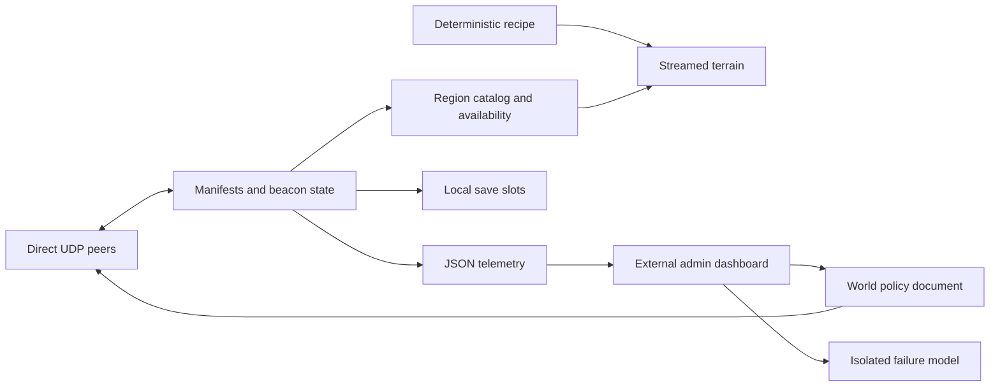

# LookUpOn: Procedural World Partitioning and Observable Peer-Held Backups in a Unity Multiplayer Prototype

Technical research report | SR University | 8 November 2026

M.Sprusheeth Rao, A.Akshith reddy, T.Snuhith, and A.Sai Varshith

School of Computer Science and Artificial Intelligence, SR University

Guide: MATHIVANA D

## Abstract

Procedural generation reduces the need to distribute prebuilt terrain, but it does not preserve player-created changes or determine which peers may serve a world region after failure. This report presents LookUpOn, a Unity multiplayer prototype that separates deterministic terrain generation, region responsibility, mutable beacon state, and operator-visible replication. The supported world covers 10 km by 10 km, partitioned into 42 independently seeded ownership regions and 2,688 rendering tiles. A locally reconstructed consistent-hash ring assigns responsibility; directly connected UDP peers exchange seed manifests and bounded pages of beacon state. A world-wide backup policy controls retention and deliberately makes departed owners' regions unavailable when backups are disabled. An external dashboard reports direct connections and actual advertised seed holders, while an isolated four-peer model explores individual retention choices. Recorded validation includes 631 Unity assertions, a two-client synchronization smoke test, and a selected owner-loss trial for each policy. In those trials, disabling backups made all 12 departed-owner regions unavailable; enabling backups preserved availability for all 16 departed-owner regions. Nine dashboard/model tests also pass. These results establish functional behavior under a local, trusted execution setting. They do not establish durable remote storage, internet-scale performance, or partition-safe authority.

Keywords: procedural generation; peer-to-peer games; consistent hashing; replication; availability; observability; Unity

## 1. Introduction

A virtual world can be represented as generated base content plus persistent changes. Reconstructing hills from a seed is fundamentally different from recovering a beacon that a player placed at a particular coordinate. Similarly, producing a mesh does not settle whether that region is available under the application's ownership rules. Treating these concerns separately makes failure behavior explicit and testable.

LookUpOn investigates this separation in a small multiplayer prototype. Its original long-term goal is an expandable world with distributed responsibilities, but the implemented artifact studied here is a bounded 100-square-kilometre battlefield. It generates terrain, roads, craters, vegetation, and ruined structures in code, and supports first-person exploration and shared survey beacons. Weapons, health, combat collision for decorations, and elimination gameplay are outside the implemented scope.

The study asks three questions. RQ1: can independently seeded ownership regions share continuous render boundaries while only a local tile neighborhood is loaded? RQ2: does an explicit retention policy produce the intended availability outcome when a primary peer disappears? RQ3: can an external operator distinguish placement preferences, reported held copies, and evidence of saved state? These questions concern implementation behavior; they do not assert optimal partition counts or large-scale performance.

The contributions are an integrated prototype design, a reproducible functional evaluation of its backup policy, and an observability/simulation workflow that exposes the difference between an assigned backup and a reported retained copy. The algorithms themselves are established techniques. No claim of a new hashing algorithm, general consistency protocol, or superior game engine is made.

## 2. Background and related work

Procedural content generation spans different representations, generation methods, and evaluation criteria. Togelius et al. organize search-based generation using a taxonomy of content, representation, and evaluation [1]. LookUpOn uses deterministic rule/noise generation rather than search-based optimization. Geometric repeatability and seams are evaluated; tactical balance, aesthetic diversity, and player experience have not been measured.

Karger et al. introduced consistent hashing for distributing cached objects while limiting reassignment as the participating set changes [2]. LookUpOn applies a ring with virtual peer positions to region responsibility. Each node reconstructs the ring from its own known membership. This is not a distributed lookup routing protocol or agreement about a globally authoritative membership view.

Colyseus separates game-object placement, discovery, and replica synchronization, with predictive replication to support interactive games [3]. LookUpOn similarly separates responsibility from held data, but does not implement distributed queries, predictive object fetching, or an evaluated high-player-count game. Its current full exchange of small manifests and beacon pages is a simpler experimental substrate.

Dynamo combines partitioning, replication, and failure-handling techniques for an available key-value service [4]. It provides useful design context for preferred replica placement and failure recovery. LookUpOn has neither Dynamo's service semantics nor its production evaluation; in particular, it lacks quorum-based write acknowledgement and versioned conflict histories.

Shapiro et al. formalize sufficient conditions for convergent replicated data types [5]. The beacon store uses deterministic duplicate/conflict resolution and repeated exchange, but a fixed capacity and intentional OFF-policy removals prevent an unconditional CRDT convergence claim. A future editable world needs explicit deletion, causal/version, and capacity semantics.

SWIM separates failure detection from membership dissemination and uses indirect probing and suspicion to reduce false failure declarations [6]. LookUpOn currently uses direct periodic updates and a fixed eight-second expiry. SWIM is a future design reference, not an implemented component. For transport, RFC 8085 emphasizes congestion behavior, reliability choices, and message sizing for UDP applications [7]; the present LAN prototype has not implemented a complete internet-safe transport design. Unity's Mesh API supplies runtime geometry construction facilities [8], but engine capability alone is not performance evidence for this project.

Chord provides distributed lookup routing in addition to hash-based responsibility [9]. LookUpOn reconstructs a ring locally and sends to known endpoints; it does not implement Chord finger tables or inherit logarithmic lookup guarantees.

Gilbert and Lynch formalize the conflict between atomic consistency and availability during partitions in their asynchronous model [10]. That result motivates an explicit future partition policy. LookUpOn's timeout and backup switch do not establish a formal CAP classification.

Raft manages agreement on a replicated log through defined leader-election, replication, and safety mechanisms [11]. Revision ordering in LookUpOn suppresses stale settings but does not implement those consensus mechanisms.

RFC 8899 specifies datagram packetization-layer path-MTU discovery [12]. It sharpens the transport work remaining beyond a fixed receive-size cap. No DPLPMTUD implementation or internet-path measurement is claimed here.

## 3. System model and design goals

The prototype assumes cooperative peers on a trusted IPv4 LAN or two local processes. Every peer runs the same recipe version, protocol, and world seed. It generates local geometry, maintains its own membership view, exchanges player poses and beacon records, and may retain other peers' seed manifests and changes. GUID-shaped IDs identify nodes; they are not cryptographic identities. Failures are modeled as process disconnection or timeout, not malicious behavior.

The system has a data plane and a local operator plane. UDP carries game state, manifests, and policy revisions between direct peers. A separate Node HTTP service reads telemetry files and writes a world-specific control document. The service is not on the game-state forwarding path, so ordinary gameplay does not require an active dashboard. Administrative changes require a local game to read the command and exchange the new policy with connected peers.

Design goals are deterministic base generation, bounded local rendering work, explicit owner-loss semantics, and evidence-based operator visibility. Strong global consistency, Byzantine tolerance, durable acknowledgement, NAT traversal, and a complete competitive-game authority model are not goals achieved by this artifact.

## 4. World partitioning and rendering

### 4.1 Spatial hierarchy

The playable interval on each horizontal axis is [-5000, 5000] metres. A 7-column by 6-row grid gives 42 ownership regions. Each region contains an 8-by-8 rendering grid, yielding 56-by-48 tiles world-wide. The requested 42-region count is a design input, not an experimentally selected optimum.

| Quantity | Value |
| --- | --- |
| Total extent and area | 10,000 by 10,000 m; 100 square kilometres |
| Ownership regions | 7 by 6; 42 total |
| Approximate region dimensions | 1,428.571 by 1,666.667 m |
| Rendering tiles per region | 8 by 8; 64 |
| Total rendering tiles | 56 by 48; 2,688 |
| Approximate tile dimensions | 178.571 by 208.333 m |
| Mesh resolutions | 32, 16, or 8 cells per side |

Table 1. Spatial hierarchy and configured mesh resolutions.

Region identity is `r = 7*z + x`. Its seed is the signed 32-bit interpretation of FNV-1a applied to `battlefield-v2:<worldSeed>:<x>:<z>`. Geometry is a function of recipe, seed, and coordinates. The validator checks that the 42 seeds for world 2026 are distinct; the hash width does not guarantee collision freedom across arbitrary inputs.

### 4.2 Boundary contract

Shared world-seeded interpolated value noise provides broad elevation. Region-seeded detail and four local craters are attenuated at regional boundaries. Roads follow shared broad terrain. Thus the regions have distinct local detail while respecting a common boundary height. This is deliberate coupling at borders, not unconstrained independent generation. The implementation uses value noise; it does not claim to implement Perlin's gradient-noise algorithm.

Mixed-resolution tiles use an eight-segment interpolated border at every detail level. Interior vertices can differ in density while their edges follow the same piecewise-linear profile. Validation compares regional and mixed-LOD edges. It does not establish bit-identical output across every CPU, graphics API, or Unity runtime version.

### 4.3 Work bounds

The renderer requests at most 11-by-11 tiles around a player, with a one-tile retention margin giving an envelope of 13-by-13 tiles while moving. Near, medium, and far bands use 32, 16, and 8 cells per side. Terrain colliders are created only for near/medium tiles. After a nine-tile warm start, one queued tile is generated per frame.

An n-by-n grid contains `2*n*n` triangles. At the three resolutions this is 2,048, 512, or 128 terrain triangles per tile, excluding decorations. These are derived geometry counts, not measured frame costs. Flat shading duplicates triangle vertices. Main-thread generation, object allocation, collider work, and rendering still require profiling; subdivision does not by itself solve all performance problems.

## 5. Peer responsibility, synchronization, and backups

### 5.1 Placement and transport

Each known peer contributes 64 FNV-hashed virtual positions. A region key hashes its grid coordinates; the first clockwise distinct peer is primary, followed by preferred secondary peers. Membership order is normalized before constructing the ring. A region's ring assignment identifies responsibility, while a separate catalog records held manifests and missing owners.

Packets are JSON over UDP, nominally every 0.15 seconds when frames permit. Discovery broadcasts to ports 47770-47777; direct endpoints and a bootstrap endpoint receive state. There is no general peer-list gossip. A packet carries pose, world/protocol identifiers, at most 24 beacon records, at most 42 manifests, memory/save fingerprints, and backup-policy metadata. Each node allows 16 remote peers and a 4,096-record beacon store. Received datagrams above 12,000 bytes are rejected; this receive bound is not an MTU-safe delivery guarantee.

Repeated pages offer best-effort anti-entropy rather than a reliable ordered stream. Same-ID beacon conflicts select a deterministic author/coordinate ordering. SHA-256 over canonical sorted beacon state supports equality comparison. It does not bind identity or prove a peer actually persisted the claimed state.

### 5.2 Availability policy

ON retains received region manifests and beacon replicas and forwards retained state. Replication currently extends to directly connected peers rather than enforcing exactly two backups. If an owner expires after another peer has received the required data, that surviving copy permits continued availability and responsibility reassignment. Failure before copy transfer can still lose data.

OFF trims retained manifests to primary responsibilities, sends only own-authored beacons, and accepts live remote changes from their active author. When the author/owner expires, surviving peers prune its live changes and mark its former terrain regions unavailable. Render tiles/colliders are removed; a player in such a region is held safely with an explicit status. Missing-owner records are saved so that restarting a survivor does not silently regenerate availability.

Importantly, OFF unavailability is an application policy. Since the terrain recipe is deterministic and present on peers, base geometry remains mathematically reconstructible. The gate demonstrates responsibility/retention semantics; it does not rely on a secret seed. Mutable player changes cannot generally be recovered from that seed. Enabling ON after all online holders disappear cannot invent missing changes; a returning valid holder may restore state it actually retained.

| Event | ON with received surviving copies | OFF or absent surviving copies |
| --- | --- | --- |
| Primary times out | Available data may be reassigned | Former region is unavailable |
| Remote author expires | Retained beacon changes remain | Its remote live changes are pruned |
| Policy becomes ON later | Existing available state can replicate | Missing state is not recreated |
| Owner/holder returns | Retained valid state can synchronize | Availability can recover from retained state |

Table 2. Intended availability and retention transitions.

### 5.3 Local persistence

Normal instances lease distinct per-world save slots through exclusive file locks. A successful save retains a stable slot identity, version, seed, beacons, manifests, and ownership records. ON saves replicas and retains the previous local version as `.bak`; OFF saves permitted own state and does not create new replica archives. Historical archives are not deleted and are inactive under OFF. Smoke mode disables persistence.

Save attempts occur periodically when serialized content changes and on normal exit. Atomic file replacement reduces partial-file exposure, but this implementation does not provide durable replicated commit acknowledgement or a demonstrated power-loss guarantee. A previous local save and a remote replica are different protection mechanisms.

## 6. External observability and failure simulation

Figure 1. Generation, peer-held state, and the separate operator plane. The failure model has no live command path.

Telemetry is exported approximately every second. The dashboard marks an observer stale after five seconds and excludes aging remote reports from fresh-holder coverage. It displays direct links from the selected observer, peer coordinates, region ownership, actual advertised holders, primary/backup inventories, state/save fingerprints, and policy acknowledgement. It does not infer remote-to-remote links or observe all network partitions globally.

The localhost service accepts a world seed and backup boolean through a same-origin JSON command with a custom header. It serializes control-file writes and chooses a revision above observed previous revisions. GUID authority breaks equal-revision ties. Games poll the file every half-second and propagate newer tuples through UDP. This suppresses stale settings; it is not consensus or authenticated administration.

The four-peer browser simulation uses the same FNV construction, 64 virtual positions, and 42-region layout, with fixed identities. It allows proposed individual retention choices, whereas live control remains world-wide. It assumes synchronization completes between actions and represents change continuity by one example record per region. Disconnect fast-forwards the eight-second timeout. Offline local copies are not counted as available; returning holders may serve their retained data again. The model does not simulate packet loss, partial transfers, disk writes, or gameplay, and never calls the live control API.

## 7. Evaluation method

The evaluation combines source inspection, recorded project artifacts from 7 November 2026, and re-executed dashboard/model checks during report preparation. The Unity build baseline is 6000.5.2f1, recipe 02, protocol 03. Two-process failure trials ran on one Windows laptop over loopback. A full CPU/GPU/RAM inventory and timing traces were not recorded, so hardware-dependent performance comparisons cannot be made.

The recorded Unity validator contains 631 assertions covering map bounds, the tested seed catalog, seams, LOD boundaries, ring behavior, UDP synchronization, policy propagation/order, failure semantics, and missing-owner restoration. This is one validation suite, not 631 independent trials. Its report is `Builds/validation.txt`.

The smoke runner starts two clients, checks above-ground positioning using terrain-only raycasts, loads nearby tiles, connects one remote per client, and exchanges a beacon. Persistence is disabled for this smoke path. The selected reports are `b787309b-peer-a.json` and `b787309b-peer-b.json` under `Builds/Smoke`.

The lifecycle runner uses isolated seeds 741901 (OFF) and 741902 (ON), ports 47880/47881, and two normal clients per case. It waits for policy acknowledgement, mutual membership, and correct advertised inventories, records manifests, terminates its second client, then compares unavailable regions against the departed peer's former responsibilities. The selected evidence is `Builds/BackupPolicy/78b4b1a9-results.json` and its two pre-failure inventory files. These are one selected trial per policy, not a paired performance experiment with identical identities.

Nine Node tests cover the local API, origin checks, telemetry freshness, model failures/recovery, hash-ring determinism, and reported-holder accounting. Browser interaction additionally checks individual switches, region counts, exact inventory selection, and the ON/OFF comparison. The evidence manifest includes file hashes and environment versions to make the report's artifact selection explicit.

## 8. Results

### 8.1 Rendering and synchronization

Both selected smoke reports pass, showing 121 loaded tiles, one known remote, and one beacon each. Player-feet Y is 95.150856 m and the terrain hit is 95.070831 m, an observed separation of about 0.080 m. Received-packet totals are 123 and 126. The reports demonstrate the specific loading, grounding, and synchronization assertions; they do not measure latency distributions, sustainable throughput, or frame rate.

### 8.2 Real inventory and owner loss

In the inspected ON case, one peer reported 16 primary plus 26 backup regions, while the other reported 26 primary plus 16 backups. Thus each advertised all 42 manifests and every region had two fresh reported holders. Matching memory fingerprints were observed, while remote disk persistence was not established.

| Initial policy | Departed-owner regions | Unavailable after expiry | Survivor loaded tiles |
| --- | --- | --- | --- |
| OFF | 12 | 12 | 110 |
| ON | 16 | 0 | 121 |

Table 3. Selected actual two-process lifecycle results. Different peer identities produced different ownership counts.

For RQ2, the conditional outcome matches the implemented policy: OFF makes every departed-owner region unavailable, while synchronized ON copies preserve those regions. The tile counts depend on player location and region availability and should not be interpreted as a rendering-speed comparison. Both lifecycle cases reported `Save failed: Access to the path is denied.` under the execution sandbox. Consequently, the result supports live retention/availability, not durable disk backup or successful crash-restart recovery.

### 8.3 Isolated model and operator visibility

With fixed simulation identities, Peer A initially owns five regions. Disabling Peer C retention changes its backup inventory from 24 to zero without removing its 18 primaries. With all retention ON, A's departure leaves 42 regions available. With all OFF, it leaves 37 available and five unavailable. Re-enabling retention leaves the five missing regions unavailable; reconnecting A restores availability from its retained local copies. The comparison control displays the same outcomes without changing real game state.

All nine Node tests pass. Browser checks show the distinction requested by RQ3: assignments, holder manifests, and memory/save evidence appear separately. This is a verified interface behavior, not a usability study or proof that telemetry is truthful. RQ1 is supported by the source's shared border contract and recorded seam assertions, within the tested build and coordinates.

## 9. Discussion and threats to validity

The most important design lesson is that geometry reconstruction, permitted availability, and mutable-state recovery are distinct. A deterministic seed can make base terrain reproducible without making player changes durable. Conversely, intentionally unavailable terrain can be enforced by catalog state even when geometry could be recomputed. The dashboard helps expose these distinctions rather than labeling every preferred secondary as a successful backup.

The study has substantial limits. One-machine processes share power, disk, operating system, and network failure domains. Loopback does not model WAN delay, loss, jitter, congestion, NAT, or partitions. The selected trials are too few for statistical reliability claims, and the policy cases have different identities/ownership distributions. Sandbox save errors prevent a durability conclusion. Current tests are developer-authored functional checks, not an independent replication study.

Internal validity is also bounded by the implementation. A fixed timeout can mistake delay for failure. Local membership disagreements can yield conflicting responsibilities. No ownership epoch or fencing prevents stale writers, and policy ordering is not distributed consensus. At capacity, divergent beacon stores need not converge. OFF deletion/pruning intentionally breaks monotonic retention. Receiving a manifest before a failure does not guarantee every associated mutable change arrived.

Security is outside the trusted prototype assumptions. Peers can forge identities, poses, digests, and policy metadata. Local HTTP origin checks do not authorize an internet operator. FNV placement and SHA-256 equality do not authenticate storage. Performance remains unmeasured: the 60 FPS application target is a configuration value, not a result. The 42-region partition and rectangular cells have not been compared against alternatives.

## 10. Future work

First, introduce per-region snapshots/edit logs, content versions, and durable replica acknowledgements, then evaluate primary and last-copy failure across at least three separate machines. Define an explicit replica factor and distinguish copying, acknowledged, under-replicated, and recovering states. Second, add ownership epochs, stale-owner fencing, and a documented partition/write policy. Individual storage opt-out requires a real protocol and durability contract before it can become a live per-peer switch.

Third, instrument frame-time percentiles, allocation/collider cost, memory, per-peer bandwidth, copy delay, and recovery time. Compare full replication with a fixed-factor/interest-based design under controlled workloads. Improve packet sizing, congestion behavior, loss handling, and membership suspicion before WAN claims. Finally, add authenticated identities/administration and a focused gameplay loop that keeps player elimination separate from storage-peer failure. Larger or effectively unbounded worlds would need a new addressing/precision and save-migration design rather than simply removing bounds.

## 11. Conclusion

LookUpOn provides a working prototype that combines deterministic region generation, streamed rendering tiles, local consistent-hash responsibility, peer-held manifests and beacon state, and external backup observability. The recorded local trials exhibit the intended ON/OFF owner-loss behavior, while the simulation makes copy retention and last-holder loss inspectable without affecting players. The results support a small functional prototype and a reproducible next research agenda. Durable multi-machine recovery, partition-safe ownership, authenticated internet operation, and scalable performance remain open implementation and evaluation tasks.

## References

[1] J. Togelius, G. N. Yannakakis, K. O. Stanley, and C. Browne. "Search-based procedural content generation: A taxonomy and survey." IEEE Transactions on Computational Intelligence and AI in Games, 3(3), 172-186, 2011. [Institutional record](https://www.um.edu.mt/library/oar/handle/123456789/29609).

[2] D. Karger, E. Lehman, T. Leighton, M. Levine, D. Lewin, and R. Panigrahy. "Consistent hashing and random trees: Distributed caching protocols for relieving hot spots on the World Wide Web." Proceedings of ACM STOC, 654-663, 1997. DOI: 10.1145/258533.258660. [Publisher record](https://doi.org/10.1145/258533.258660); [author-hosted paper](https://people.csail.mit.edu/karger/Papers/web.pdf).

[3] A. Bharambe, J. Pang, and S. Seshan. "Colyseus: A distributed architecture for online multiplayer games." Proceedings of USENIX NSDI, 2006. [Paper](https://www.usenix.org/legacy/event/nsdi06/tech/full_papers/bharambe/bharambe_html/).

[4] G. DeCandia, D. Hastorun, M. Jampani, G. Kakulapati, A. Lakshman, A. Pilchin, S. Sivasubramanian, P. Vosshall, and W. Vogels. "Dynamo: Amazon's highly available key-value store." Proceedings of ACM SOSP, 2007. [Amazon Science record](https://www.amazon.science/publications/dynamo-amazons-highly-available-key-value-store); [author-hosted paper](https://www.allthingsdistributed.com/files/amazon-dynamo-sosp2007.pdf).

[5] M. Shapiro, N. Preguica, C. Baquero, and M. Zawirski. "Conflict-free replicated data types." Stabilization, Safety, and Security of Distributed Systems (SSS), 2011. [Author-hosted paper](https://perso.lip6.fr/Marc.Shapiro/papers/2011/CRDTs_SSS-2011.pdf).

[6] A. Das, I. Gupta, and A. Motivala. "SWIM: Scalable weakly-consistent infection-style process group membership protocol." Proceedings of the International Conference on Dependable Systems and Networks, 303-312, 2002. DOI: 10.1109/DSN.2002.1028914. [Cornell paper](https://www.cs.cornell.edu/projects/Quicksilver/public_pdfs/SWIM.pdf).

[7] L. Eggert, G. Fairhurst, and G. Shepherd. "UDP Usage Guidelines." RFC 8085, BCP 145, March 2017. DOI: 10.17487/RFC8085. [RFC Editor](https://www.rfc-editor.org/rfc/rfc8085). The RFC record notes an update by RFC 8899.

[8] Unity Technologies. "Mesh - UnityEngine scripting reference, Unity 6000.0." [Official documentation](https://docs.unity.com/en-us/engine/6000.0/script-reference/unityengine/mesh). This is the API background reference; the evaluated project pins editor 6000.5.2f1.

[9] I. Stoica, R. Morris, D. Karger, M. F. Kaashoek, and H. Balakrishnan. "Chord: A scalable peer-to-peer lookup service for Internet applications." ACM SIGCOMM, 2001. [Author-hosted manuscript](https://people.csail.mit.edu/karger/Papers/chord.pdf).

[10] S. Gilbert and N. Lynch. "Brewer's conjecture and the feasibility of consistent, available, partition-tolerant web services." ACM SIGACT News, 33(2), 51-59, 2002. [MIT manuscript](https://groups.csail.mit.edu/tds/papers/Gilbert/Brewer6.pdf).

[11] D. Ongaro and J. Ousterhout. "In search of an understandable consensus algorithm." USENIX Annual Technical Conference, 305-319, 2014. [Conference record](https://www.usenix.org/node/184041.).

[12] G. Fairhurst, T. Jones, M. Tuxen, I. Rungeler, and T. Volker. "Packetization Layer Path MTU Discovery for Datagram Transports." RFC 8899, September 2020. [RFC Editor](https://www.rfc-editor.org/rfc/rfc8899.html).

References [1]-[8] were verified on 7 November 2026; references [9]-[12] were verified on 8 November 2026. They support background/design discussion; project measurements come from the local artifacts identified in Section 7. The institutional PCG record supports the taxonomy overview; its restricted full text was not required for that claim.

## Appendix A. Reproduction entry points

Open the project with Unity 6000.5.2f1 and run `LookUpOn > Validate prototype`. Build through `LookUpOn > Build Windows prototype` after preserving custom scene work. From the project root, run `node --test AdminPanel/server.test.mjs AdminPanel/simulation.test.mjs`. Use `Tools/Test-TwoPeers.ps1` for the persistence-disabled smoke case. Start `node AdminPanel/server.mjs`, then use `Tools/Test-BackupPolicy.ps1` for actual inventory and owner-loss tests. The optional `-InspectSeconds 60` pauses the connected ON case for dashboard inspection. See `docs/TESTING.md` for ports, seed isolation, expected assertions, and limitations.

The report package includes `references.bib`, `sources.json`, and `evidence/manifest.json`. The manifest records the selected evidence and source hashes at preparation time. It does not constitute a signed release, an independent replication, or evidence that the current file tree will never change.
