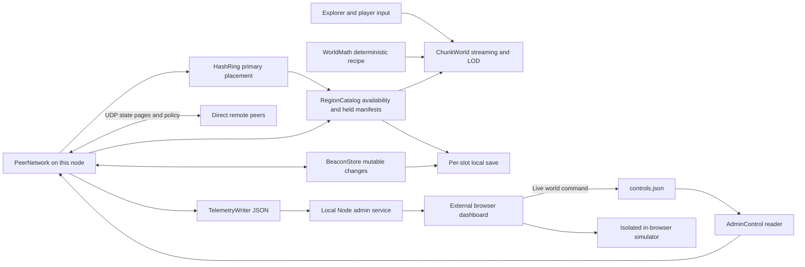

# LookUpOn architecture

Baseline: recipe 03, protocol 04, telemetry schema 2. The main [README](../README.md) is the operational guide.

## Component flow

The simulator has no command path back to the live world. The Node service is a local control/observability component, not a central gameplay host.

## Addressing and generation

Coordinates use metres, with X/Z in [-5000,5000]. World regions form a 7 × 6 grid; rendering tiles form a 56 × 48 grid. Region ID is `z * 7 + x`. Position-to-tile indexing floors the shifted coordinate and clamps exact outer bounds to the last tile.

Regional seed derivation is the signed 32-bit interpretation of FNV-1a over `battlefield-v2:<worldSeed>:<regionX>:<regionZ>`. It is deterministic, not cryptographic. The tested 42 seeds for seed 2026 are distinct; a 32-bit hash does not guarantee collision freedom for arbitrary worlds.

Broad height uses world-seeded noise for upland relief and a continuous valley function for the river and track. Region-seeded detail fades at borders. Rendering tiles at different resolutions use the same eight-segment boundary interpolation and sample shared terrain normals.

`ChunkWorld` requests radius-five tiles, retains radius-six tiles, prioritizes nearby work, and builds one queued tile per frame after nine warm-start tiles. Chebyshev tile distance selects 32/16/8 cells per side. Near and medium meshes have terrain colliders. `ValleyScenery` builds seeded trees, grasses, rocks and river surfaces alongside the tile. Terrain uses an indexed mesh with smooth normals and world-space surface materials. Mesh construction runs on the main thread.

## Membership and placement

Each known peer contributes 64 virtual positions to a locally reconstructed ring. Peer virtual positions mix the FNV hash before sorting to spread adjacent suffixes. A region's first clockwise distinct peer is its primary. Subsequent distinct peers are preferred secondary assignments. Membership is local and may differ across nodes.

The UDP implementation sends every 0.15 s when frames permit, broadcasts discovery to eight standard ports, and sends directly to known endpoints/bootstrap. It accepts valid matching-world/protocol packets, validates IDs, finite positions, map bounds, digest shape, and array sizes. It expires peers when heartbeat age exceeds eight seconds. Peer-list dissemination, suspicion/refutation, reliable delivery, and partition fencing are absent.

## Two forms of state

1. **Reconstructible base geometry:** a recipe, world seed, coordinates, and regional seed determine terrain. A retained manifest is small metadata, not a full terrain mesh backup.
2. **Mutable changes:** survey beacons have IDs, authors, and X/Z. The store resolves same-ID conflicts deterministically by author/coordinate ordering and repeatedly exchanges at most 24 records per packet. A cached SHA-256 fingerprint covers canonical sorted state. Matching fingerprints are convergence evidence, not storage attestations.

ON forwards retained changes and manifests to directly connected peers. It does not restrict storage to the ring's two preferred backups. OFF forwards own-authored changes and accepts remote changes from their currently active author only; remote state is not saved as a backup. A bounded store and OFF removal mean unconditional CRDT convergence claims are inappropriate.

## Availability transitions

| Event | ON with surviving received data | OFF / no surviving data |
| --- | --- | --- |
| Owner times out | Retained data permits continued availability and reassignment | Previous owner is marked missing; region stays unavailable |
| Renderer refreshes | Available local tiles stream normally | Unavailable tiles and colliders unload |
| Player stands in missing region | No special case if available | Controller holds position with an explicit status |
| Policy becomes ON | Available held data is copied | Missing state is not invented |
| Original owner returns | Its retained valid data may rejoin | Owner identity can clear missing ownership; state it still retains can synchronize |
| Survivor saves/restarts | Held catalog/state are loaded | Missing-owner records survive restart |

The OFF behavior is an explicit availability rule, not a claim that procedural geometry becomes computationally unknowable. A base seed cannot reconstruct a user's unsaved edit history.

## Persistence

Normal instances lease one of 32 per-world local files using exclusive lock streams. Slots keep stable saved GUID identities. JSON snapshots contain version/recipe, seed, policy flag, identity, beacons, manifests, and 42 owner records. Save replacement is atomic at the file-operation level; ON keeps the previous file as `.bak`. This does not establish crash-proof fsync semantics or replication acknowledgement. Smoke mode disables persistence. Failed saves invalidate the reported saved-state digest.

The policy revision/authority is maintained through control documents and packets, not a consensus log. No offline global policy authority is guaranteed. The normal deployment expects `AdminPanel` two levels above `Builds/Windows`; moving the executable alone breaks that local discovery path.

## Control and observation

`POST /api/control` accepts a signed-32-bit world seed and boolean policy with localhost host/origin checks, JSON content type, a custom request header, and a body bound. Serialized writes persist a revision greater than previous observed revisions, with GUID authority as a tie-breaker. The game reads every 0.5 seconds and propagates the newest tuple `(revision, authority)` in UDP packets. A pending UI state lasts until the selected game reports acknowledgement.

The HTTP service exposes an allowlisted set of static assets and `GET /api/state`. It reads editor/standalone telemetry, ignores old schema 1, skips partial/bad files, and marks snapshots stale after five seconds. Region holder arrays derive from local retained records and recent validated remote manifest IDs. The connection graph is a star from the selected observer; it does not invent remote-to-remote links. Loss exposure conservatively flags regions without another fresh reported holder.

Telemetry files include local paths and endpoints. Treat exports as development data. Localhost origin checks, GUID syntax checks, FNV placement, and SHA-256 fingerprints do not authenticate peers or operators.

## Simulation boundary

The browser model uses the same FNV hash construction and 64 virtual positions, four fixed GUID-shaped identities, and the same region layout. It assumes completed copy transfer between actions. Offline copies remain local but cannot serve others. Per-peer OFF prunes non-primary copies; disconnection immediately advances simulated time by eight seconds. Missing regions cannot recover solely from enabling retention. A returning holder can restore retained state.

World backup policy is propagated over UDP. A local retention override further limits the target peer to its primary seed manifests and authored changes for storage and relay. The dashboard writes commands to a local control file. Connection commands match a single process run ID, and the game acknowledges commands in telemetry. The browser simulation uses an example change record. See [testing](TESTING.md) and [the paper](../Research/LookUpOn-Research-Paper.md).
